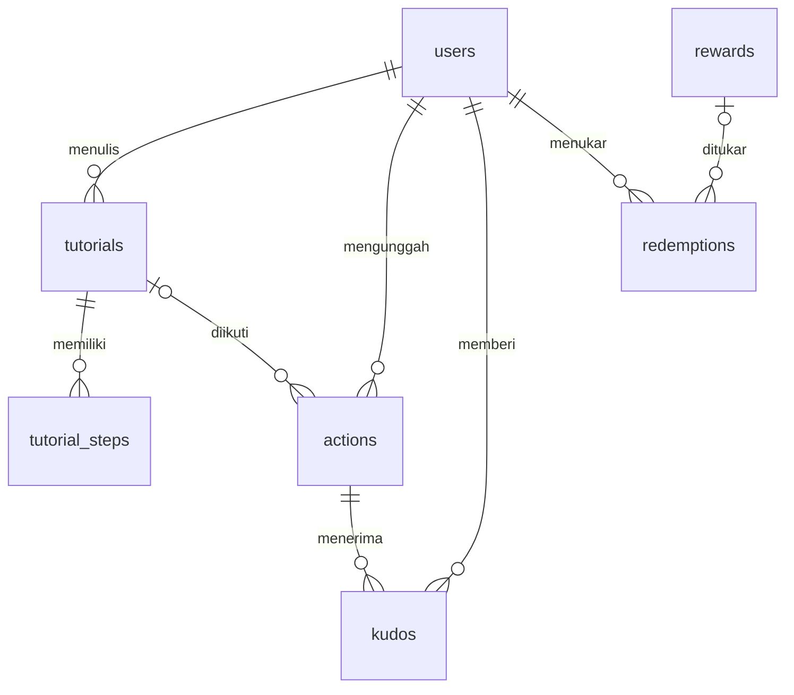

# Dokumentasi REST API EcoCraft

API terpusat (Node.js + Express + SQLite) yang dipakai bersama oleh **Web (React)**, **Mobile (React Native)**, dan **Desktop (C# WinForms)**. Semua klien membaca dan menulis ke satu database yang sama melalui endpoint di bawah ini.

| Item | Nilai |
|---|---|
| Base URL (komputer sendiri) | `http://localhost:3000` |
| Base URL (HP / komputer lain) | `http://<IP-LAN-server>:3000` (alamat dicetak di terminal saat server menyala) |
| Format data | JSON (`Content-Type: application/json`), kecuali unggah foto (`multipart/form-data`) |
| Respons sukses | `{ "message": string, "data": ... }` |
| Respons error | `{ "message": string, "errors"?: { field: pesan } }` |
| Autentikasi | JWT. Login lewat `POST /api/auth/login`, lalu kirim header `Authorization: Bearer <token>` |
| Daftar endpoint langsung dari server | `GET /api` |

**Akses:** *Publik* = tanpa token. *Token opsional* = boleh tanpa token; bila dikirim, field `likedByMe` terisi. *Wajib login* = harus mengirim token. *Admin* = token akun ber-role `admin`.

**Akun data awal:** admin `admin@ecocraft.id` / `admin123`; anggota `sarah@ecocraft.id`, `rizky@ecocraft.id`, `dimas@ecocraft.id`, `anisa@ecocraft.id`, dan lainnya dengan kata sandi `eco12345`.

## Ringkasan endpoint

| No | Method | Endpoint | Akses | Request | Response sukses |
|---|---|---|---|---|---|
| 1 | `GET` | `/` | Publik | - | `200` info server |
| 2 | `GET` | `/api` | Publik | - | `200` `{ baseUrl, auth, endpoints[] }` |
| 3 | `GET` | `/api/materials` | Publik | - | `200` `{ materials[], difficulties[], rules }` |
| 4 | `GET` | `/api/stats` | Publik | - | `200` `{ members, tutorials, actions{}, totalWeightKg, totalCo2Kg }` |
| 5 | `POST` | `/api/auth/register` | Publik | Body JSON: `name` (2–60 karakter), `email`, `password` (min. 6) | `201` `{ token, user }` |
| 6 | `POST` | `/api/auth/login` | Publik | Body JSON: `email`, `password` | `200` `{ token, user }` |
| 7 | `GET` | `/api/me` | Wajib login | Header Authorization | `200` User + `stats` |
| 8 | `GET` | `/api/me/actions` | Wajib login | Header Authorization | `200` Action[] |
| 9 | `GET` | `/api/me/redemptions` | Wajib login | Header Authorization | `200` Redemption[] |
| 10 | `GET` | `/api/tutorials` | Publik | Query opsional: `material`, `q`, `maxDuration` | `200` Tutorial[] |
| 11 | `GET` | `/api/tutorials/:id` | Publik | Parameter `:id` | `200` Tutorial + `steps[]` |
| 12 | `POST` | `/api/tutorials` | Admin | Body JSON: `title`, `material`, `difficulty` (Sangat mudah, Mudah, Sedang, Sulit), `durationMinutes`, `steps[]`; opsional `description`, `co2SavedKg`, `xpReward`, `imageUrl` | `201` Tutorial + `steps[]` |
| 13 | `PUT` | `/api/tutorials/:id` | Admin | Body JSON sama dengan POST | `200` Tutorial + `steps[]` |
| 14 | `DELETE` | `/api/tutorials/:id` | Admin | Parameter `:id` | `200` `{ id }` |
| 15 | `GET` | `/api/actions` | Publik (token opsional) | Query opsional: `status`, `material`, `userId`, `tutorialId` | `200` Action[] |
| 16 | `GET` | `/api/actions/:id` | Publik (token opsional) | Parameter `:id` | `200` Action |
| 17 | `POST` | `/api/uploads` | Wajib login | Body **form-data**: field `image` (file JPG/PNG/WEBP, maks. 3 MB) | `201` `{ url, path, size, mimeType }` |
| 18 | `POST` | `/api/actions` | Wajib login | Body JSON: `title`, `material`, `weightKg` (0,1–10), `imageUrl`; opsional `tutorialId` | `201` Action (status `pending`) |
| 19 | `PATCH` | `/api/actions/:id` | Wajib login (pemilik) | Body JSON (minimal satu): `title`, `material`, `weightKg`, `imageUrl` | `200` Action |
| 20 | `POST` | `/api/actions/:id/kudos` | Wajib login (bukan pemilik) | Tanpa body | `201` Action |
| 21 | `DELETE` | `/api/actions/:id/kudos` | Wajib login | Tanpa body | `200` Action |
| 22 | `PATCH` | `/api/actions/:id/status` | Admin | Body JSON: `status` = `pending` / `verified` / `rejected` | `200` Action |
| 23 | `DELETE` | `/api/actions/:id` | Wajib login (pemilik saat pending) / Admin | Parameter `:id` | `200` `{ id }` |
| 24 | `GET` | `/api/drop-points` | Publik | Query opsional: `material` | `200` DropPoint[] |
| 25 | `GET` | `/api/drop-points/:id` | Publik | Parameter `:id` | `200` DropPoint |
| 26 | `POST` | `/api/drop-points` | Admin | Body JSON: `name`, `type`, `latitude`, `longitude`, `materials[]`; opsional `address`, `openingHours` | `201` DropPoint |
| 27 | `PUT` | `/api/drop-points/:id` | Admin | Body JSON sama dengan POST | `200` DropPoint |
| 28 | `DELETE` | `/api/drop-points/:id` | Admin | Parameter `:id` | `200` `{ id }` |
| 29 | `GET` | `/api/rewards` | Publik | - | `200` Reward[] |
| 30 | `GET` | `/api/rewards/:id` | Publik | Parameter `:id` | `200` Reward |
| 31 | `POST` | `/api/rewards` | Admin | Body JSON: `name`, `costCoins`, `stock`; opsional `partner`, `description` | `201` Reward |
| 32 | `PUT` | `/api/rewards/:id` | Admin | Body JSON sama dengan POST | `200` Reward |
| 33 | `DELETE` | `/api/rewards/:id` | Admin | Parameter `:id` | `200` `{ id }` |
| 34 | `POST` | `/api/rewards/:id/redeem` | Wajib login | Tanpa body | `201` `{ redemption, balance }` |

## Kode status

| Kode | Arti | Contoh penyebab |
|---|---|---|
| 200 | OK | Data berhasil diambil, diubah, atau dihapus |
| 201 | Created | Data baru dibuat (register, POST, kudos, penukaran) |
| 400 | Bad Request | Field wajib kosong, format salah, JSON rusak; detail per field di `errors` |
| 401 | Unauthorized | Token tidak dikirim, salah, atau kedaluwarsa; email/kata sandi salah |
| 403 | Forbidden | Bukan admin, mengubah aksi milik orang lain, memberi kudos ke aksi sendiri |
| 404 | Not Found | ID tidak ada atau endpoint tidak terdaftar |
| 409 | Conflict | Email sudah terdaftar, kudos ganda, koin tidak cukup, stok habis, aksi sudah terverifikasi |
| 413 / 415 | Payload Too Large / Unsupported Media Type | Foto lebih dari 3 MB / bukan JPG, PNG, WEBP |
| 500 | Internal Server Error | Kesalahan tak terduga di server |

## Detail endpoint

Contoh respons di bawah diambil langsung dari server dengan data awal. Array dipersingkat menjadi satu item.

### Umum

#### `GET /`

Cek server berjalan.

- **Akses:** Publik
- **Request:** -

**Response `200`**

```json
{
  "message": "EcoCraft API berjalan 🚀",
  "data": {
    "name": "EcoCraft API",
    "version": "1.0.0",
    "docs": "http://localhost:3000/api"
  }
}
```

#### `GET /api`

Daftar seluruh endpoint beserta akses dan body-nya.

- **Akses:** Publik
- **Request:** -

**Response `200`**

```json
{
  "message": "Daftar endpoint EcoCraft API",
  "data": {
    "baseUrl": "http://localhost:3000",
    "responseFormat": {
      "success": "{ message, data }",
      "error": "{ message, errors? }"
    },
    "auth": "Header Authorization: Bearer <token> (token dari POST /api/auth/login)",
    "endpoints": [
      {
        "group": "Umum",
        "method": "GET",
        "path": "/",
        "auth": "publik",
        "description": "Cek server berjalan"
      }
    ]
  }
}
```

#### `GET /api/materials`

Daftar bahan (kunci, label, warna, faktor CO2e), tingkat kesulitan, dan aturan poin. Dipakai klien untuk mengisi dropdown.

- **Akses:** Publik
- **Request:** -

**Response `200`**

```json
{
  "message": "Daftar bahan berhasil diambil",
  "data": {
    "materials": [
      {
        "key": "plastik",
        "label": "Plastik",
        "color": "#2F6F9F",
        "co2FactorKgPerKg": 1.5
      }
    ],
    "difficulties": [
      "Sangat mudah"
    ],
    "rules": {
      "kudosToVerify": 5,
      "coinsPerKg": 100,
      "minCoins": 30,
      "minWeightKg": 0.1,
      "maxWeightKg": 10,
      "xpPerLevel": 500,
      "defaultActionXp": 20
    }
  }
}
```

#### `GET /api/stats`

Ringkasan statistik untuk dashboard (aksi, berat limbah, CO2e terverifikasi).

- **Akses:** Publik
- **Request:** -

**Response `200`**

```json
{
  "message": "Statistik berhasil diambil",
  "data": {
    "members": 10,
    "tutorials": 6,
    "dropPoints": 6,
    "actions": {
      "total": 4,
      "pending": 2,
      "verified": 2,
      "rejected": 0
    },
    "totalWeightKg": 1.3,
    "totalCo2Kg": 1.4,
    "redemptions": 1
  }
}
```

### Autentikasi

#### `POST /api/auth/register`

Mendaftarkan akun anggota baru dan langsung mengembalikan token.

- **Akses:** Publik
- **Request:** Body JSON: `name` (2–60 karakter), `email`, `password` (min. 6)

```json
{
  "name": "Budi Santoso",
  "email": "budi@contoh.id",
  "password": "rahasia123"
}
```

**Response `201`**

```json
{
  "message": "Registrasi berhasil",
  "data": {
    "token": "eyJhbGciOiJIUzI1NiIsInR5...",
    "user": {
      "id": 12,
      "name": "Budi Santoso",
      "email": "budi@contoh.id",
      "role": "member",
      "coins": 0,
      "xp": 0,
      "level": 1,
      "xpPerLevel": 500,
      "createdAt": "2026-10-30T12:10:13Z"
    }
  }
}
```

#### `POST /api/auth/login`

Login. Simpan `token` lalu kirim di header `Authorization: Bearer <token>`.

- **Akses:** Publik
- **Request:** Body JSON: `email`, `password`

```json
{
  "email": "sarah@ecocraft.id",
  "password": "eco12345"
}
```

**Response `200`**

```json
{
  "message": "Login berhasil",
  "data": {
    "token": "eyJhbGciOiJIUzI1NiIsInR5...",
    "user": {
      "id": 2,
      "name": "Sarah Amalia",
      "email": "sarah@ecocraft.id",
      "role": "member",
      "coins": 350,
      "xp": 420,
      "level": 1,
      "xpPerLevel": 500,
      "createdAt": "2026-09-30T12:10:09Z"
    }
  }
}
```

### Profil

#### `GET /api/me`

Profil pengguna yang login, saldo Eco-Coins, XP, level, dan statistik.

- **Akses:** Wajib login
- **Request:** Header Authorization

**Response `200`**

```json
{
  "message": "Profil berhasil diambil",
  "data": {
    "id": 2,
    "name": "Sarah Amalia",
    "email": "sarah@ecocraft.id",
    "role": "member",
    "coins": 350,
    "xp": 420,
    "level": 1,
    "xpPerLevel": 500,
    "createdAt": "2026-09-30T12:10:09Z",
    "stats": {
      "actions": 1,
      "verifiedActions": 0,
      "pendingActions": 1,
      "pendingCoins": 60,
      "totalWeightKg": 0,
      "totalCo2Kg": 0
    }
  }
}
```

#### `GET /api/me/actions`

Semua aksi milik pengguna, termasuk yang ditolak. Query opsional `status`.

- **Akses:** Wajib login
- **Request:** Header Authorization

**Response `200`**

```json
{
  "message": "Aksi milikmu berhasil diambil",
  "data": [
    {
      "id": 1,
      "title": "Selesai membuat pot gantung dari botol bekas air mineral.",
      "material": "plastik",
      "weightKg": 0.6,
      "co2Kg": 0.9,
      "coins": 60,
      "xp": 50,
      "imageUrl": "http://localhost:3000/static/illustrations/pot.svg",
      "status": "pending",
      "kudosCount": 2,
      "kudosNeeded": 5,
      "likedByMe": false,
      "user": {
        "id": 2,
        "name": "Sarah Amalia"
      },
      "tutorial": {
        "id": 1,
        "title": "Pot Tanaman Gantung dari Botol Plastik"
      },
      "createdAt": "2026-10-30T12:06:10Z",
      "verifiedAt": null
    }
  ]
}
```

#### `GET /api/me/redemptions`

Riwayat penukaran reward beserta kode voucher.

- **Akses:** Wajib login
- **Request:** Header Authorization

**Response `200`**

```json
{
  "message": "Riwayat penukaran berhasil diambil",
  "data": [
    {
      "id": 1,
      "reward": {
        "id": 1,
        "name": "Paket bibit tanaman hias"
      },
      "costCoins": 150,
      "voucherCode": "ECO-SEED-B1B1T",
      "createdAt": "2026-10-27T12:10:10Z"
    }
  ]
}
```

### Tutorial

#### `GET /api/tutorials?material=kaca`

Daftar tutorial. Query opsional: `material` (plastik, kardus, tekstil, kaca, logam, organik), `q` (kata kunci), `maxDuration` (menit).

- **Akses:** Publik
- **Request:** Query opsional: `material`, `q`, `maxDuration`

**Response `200`**

```json
{
  "message": "Data tutorial berhasil diambil",
  "data": [
    {
      "id": 4,
      "title": "Vas Bunga Elegan dari Botol Kaca",
      "description": "Botol sirup bekas dililit tali rami menjadi vas bunga.",
      "material": "kaca",
      "difficulty": "Sedang",
      "durationMinutes": 6,
      "co2SavedKg": 0.9,
      "xpReward": 80,
      "imageUrl": "http://localhost:3000/static/illustrations/vas.svg",
      "author": {
        "id": 9,
        "name": "Dewi Lestari"
      },
      "stepCount": 2,
      "createdAt": "2026-10-30T12:10:10Z",
      "updatedAt": "2026-10-30T12:10:10Z"
    }
  ]
}
```

#### `GET /api/tutorials/1`

Detail tutorial beserta langkah-langkahnya (`steps`).

- **Akses:** Publik
- **Request:** Parameter `:id`

**Response `200`**

```json
{
  "message": "Detail tutorial berhasil diambil",
  "data": {
    "id": 1,
    "title": "Pot Tanaman Gantung dari Botol Plastik",
    "description": "Ubah botol minuman bekas menjadi pot gantung untuk tanaman hias kecil.",
    "material": "plastik",
    "difficulty": "Mudah",
    "durationMinutes": 4,
    "co2SavedKg": 0.2,
    "xpReward": 50,
    "imageUrl": "http://localhost:3000/static/illustrations/pot.svg",
    "author": {
      "id": 6,
      "name": "Rina Eco"
    },
    "stepCount": 3,
    "createdAt": "2026-10-30T12:10:10Z",
    "updatedAt": "2026-10-30T12:10:10Z",
    "steps": [
      {
        "id": 1,
        "stepOrder": 1,
        "description": "Bersihkan botol plastik bekas minuman. Potong bagian tengah botol secara memanjang menggunakan gunting.",
        "imageUrl": null
      },
      {
        "id": 2,
        "stepOrder": 2,
        "description": "Buat 3–4 lubang kecil di bagian bawah botol untuk resapan air tanaman.",
        "imageUrl": null
      }
    ]
  }
}
```

#### `POST /api/tutorials`

Menambah tutorial beserta langkahnya.

- **Akses:** Admin
- **Request:** Body JSON: `title`, `material`, `difficulty` (Sangat mudah, Mudah, Sedang, Sulit), `durationMinutes`, `steps[]`; opsional `description`, `co2SavedKg`, `xpReward`, `imageUrl`

```json
{
  "title": "Celengan dari Kaleng Bekas",
  "description": "Kaleng susu bekas menjadi celengan.",
  "material": "logam",
  "difficulty": "Mudah",
  "durationMinutes": 7,
  "co2SavedKg": 0.3,
  "xpReward": 40,
  "imageUrl": null,
  "steps": [
    {
      "description": "Bersihkan kaleng dan haluskan tepinya."
    },
    {
      "description": "Lubangi tutup kaleng lalu hias."
    }
  ]
}
```

**Response `201`**

```json
{
  "message": "Tutorial berhasil ditambahkan",
  "data": {
    "id": 7,
    "title": "Celengan dari Kaleng Bekas",
    "description": "Kaleng susu bekas menjadi celengan.",
    "material": "logam",
    "difficulty": "Mudah",
    "durationMinutes": 7,
    "co2SavedKg": 0.3,
    "xpReward": 40,
    "imageUrl": null,
    "author": {
      "id": 1,
      "name": "Admin EcoCraft"
    },
    "stepCount": 2,
    "createdAt": "2026-10-30T12:10:13Z",
    "updatedAt": "2026-10-30T12:10:13Z",
    "steps": [
      {
        "id": 14,
        "stepOrder": 1,
        "description": "Bersihkan kaleng dan haluskan tepinya.",
        "imageUrl": null
      },
      {
        "id": 15,
        "stepOrder": 2,
        "description": "Lubangi tutup kaleng lalu hias.",
        "imageUrl": null
      }
    ]
  }
}
```

#### `PUT /api/tutorials/7`

Mengganti seluruh isi tutorial. Daftar langkah lama diganti dengan `steps` yang dikirim.

- **Akses:** Admin
- **Request:** Body JSON sama dengan POST

```json
{
  "title": "Celengan Kaleng Warna-warni",
  "description": "Kaleng susu bekas menjadi celengan.",
  "material": "logam",
  "difficulty": "Mudah",
  "durationMinutes": 7,
  "co2SavedKg": 0.3,
  "xpReward": 40,
  "imageUrl": null,
  "steps": [
    {
      "description": "Bersihkan kaleng, cat, lalu lubangi tutupnya."
    }
  ]
}
```

**Response `200`**

```json
{
  "message": "Tutorial berhasil diperbarui",
  "data": {
    "id": 7,
    "title": "Celengan Kaleng Warna-warni",
    "description": "Kaleng susu bekas menjadi celengan.",
    "material": "logam",
    "difficulty": "Mudah",
    "durationMinutes": 7,
    "co2SavedKg": 0.3,
    "xpReward": 40,
    "imageUrl": null,
    "author": {
      "id": 1,
      "name": "Admin EcoCraft"
    },
    "stepCount": 1,
    "createdAt": "2026-10-30T12:10:13Z",
    "updatedAt": "2026-10-30T12:10:13Z",
    "steps": [
      {
        "id": 16,
        "stepOrder": 1,
        "description": "Bersihkan kaleng, cat, lalu lubangi tutupnya.",
        "imageUrl": null
      }
    ]
  }
}
```

#### `DELETE /api/tutorials/7`

Menghapus tutorial dan langkahnya. Aksi yang mengacu ke tutorial ini tetap ada (tutorial menjadi null).

- **Akses:** Admin
- **Request:** Parameter `:id`

**Response `200`**

```json
{
  "message": "Tutorial berhasil dihapus",
  "data": {
    "id": 7
  }
}
```

### Aksi

#### `GET /api/actions?status=pending`

Feed aksi komunitas, terbaru di atas. Tanpa filter, aksi yang ditolak tidak ditampilkan. Query opsional: `status`, `material`, `userId`, `tutorialId`. Bila token dikirim, `likedByMe` terisi.

- **Akses:** Publik (token opsional)
- **Request:** Query opsional: `status`, `material`, `userId`, `tutorialId`

**Response `200`**

```json
{
  "message": "Data aksi berhasil diambil",
  "data": [
    {
      "id": 1,
      "title": "Selesai membuat pot gantung dari botol bekas air mineral.",
      "material": "plastik",
      "weightKg": 0.6,
      "co2Kg": 0.9,
      "coins": 60,
      "xp": 50,
      "imageUrl": "http://localhost:3000/static/illustrations/pot.svg",
      "status": "pending",
      "kudosCount": 2,
      "kudosNeeded": 5,
      "likedByMe": false,
      "user": {
        "id": 2,
        "name": "Sarah Amalia"
      },
      "tutorial": {
        "id": 1,
        "title": "Pot Tanaman Gantung dari Botol Plastik"
      },
      "createdAt": "2026-10-30T12:06:10Z",
      "verifiedAt": null
    },
    "... (1 item lainnya)"
  ]
}
```

#### `GET /api/actions/1`

Detail satu aksi.

- **Akses:** Publik (token opsional)
- **Request:** Parameter `:id`

**Response `200`**

```json
{
  "message": "Detail aksi berhasil diambil",
  "data": {
    "id": 1,
    "title": "Selesai membuat pot gantung dari botol bekas air mineral.",
    "material": "plastik",
    "weightKg": 0.6,
    "co2Kg": 0.9,
    "coins": 60,
    "xp": 50,
    "imageUrl": "http://localhost:3000/static/illustrations/pot.svg",
    "status": "pending",
    "kudosCount": 2,
    "kudosNeeded": 5,
    "likedByMe": false,
    "user": {
      "id": 2,
      "name": "Sarah Amalia"
    },
    "tutorial": {
      "id": 1,
      "title": "Pot Tanaman Gantung dari Botol Plastik"
    },
    "createdAt": "2026-10-30T12:06:10Z",
    "verifiedAt": null
  }
}
```

### Unggah

#### `POST /api/uploads`

Mengunggah foto bukti. Gunakan `url` dari respons sebagai `imageUrl` saat membuat aksi.

- **Akses:** Wajib login
- **Request:** Body **form-data**: field `image` (file JPG/PNG/WEBP, maks. 3 MB)

```
form-data: image = <file foto>
```

**Response `201`**

```json
{
  "message": "Foto berhasil diunggah",
  "data": {
    "url": "http://localhost:3000/uploads/1793362213623-70d67c3f.png",
    "path": "/uploads/1793362213623-70d67c3f.png",
    "size": 70,
    "mimeType": "image/png"
  }
}
```

### Aksi

#### `POST /api/actions`

Mengirim bukti aksi. Server menghitung `co2Kg`, `coins`, dan `xp`. Status awal `pending`.

- **Akses:** Wajib login
- **Request:** Body JSON: `title`, `material`, `weightKg` (0,1–10), `imageUrl`; opsional `tutorialId`

```json
{
  "title": "Tas belanja dari kaos lama",
  "material": "tekstil",
  "weightKg": 0.4,
  "imageUrl": "http://localhost:3000/static/illustrations/totebag.svg",
  "tutorialId": 3
}
```

**Response `201`**

```json
{
  "message": "Aksi berhasil dikirim dan menunggu verifikasi komunitas",
  "data": {
    "id": 5,
    "title": "Tas belanja dari kaos lama",
    "material": "tekstil",
    "weightKg": 0.4,
    "co2Kg": 1.2,
    "coins": 40,
    "xp": 40,
    "imageUrl": "http://localhost:3000/static/illustrations/totebag.svg",
    "status": "pending",
    "kudosCount": 0,
    "kudosNeeded": 5,
    "likedByMe": false,
    "user": {
      "id": 2,
      "name": "Sarah Amalia"
    },
    "tutorial": {
      "id": 3,
      "title": "Totebag dari Kaos Bekas Tanpa Jahit"
    },
    "createdAt": "2026-10-30T12:10:13Z",
    "verifiedAt": null
  }
}
```

#### `PATCH /api/actions/5`

Mengubah sebagian data aksi milik sendiri selama masih `pending`. Koin dan CO2e dihitung ulang.

- **Akses:** Wajib login (pemilik)
- **Request:** Body JSON (minimal satu): `title`, `material`, `weightKg`, `imageUrl`

```json
{
  "weightKg": 0.6
}
```

**Response `200`**

```json
{
  "message": "Aksi berhasil diperbarui",
  "data": {
    "id": 5,
    "title": "Tas belanja dari kaos lama",
    "material": "tekstil",
    "weightKg": 0.6,
    "co2Kg": 1.8,
    "coins": 60,
    "xp": 40,
    "imageUrl": "http://localhost:3000/static/illustrations/totebag.svg",
    "status": "pending",
    "kudosCount": 0,
    "kudosNeeded": 5,
    "likedByMe": false,
    "user": {
      "id": 2,
      "name": "Sarah Amalia"
    },
    "tutorial": {
      "id": 3,
      "title": "Totebag dari Kaos Bekas Tanpa Jahit"
    },
    "createdAt": "2026-10-30T12:10:13Z",
    "verifiedAt": null
  }
}
```

#### `POST /api/actions/5/kudos`

Memberi Eco-Kudos. Kudos ke-5 mengubah status menjadi `verified` dan mencairkan Eco-Coins serta XP ke pemilik aksi. (Contoh ini kudos ke-5.)

- **Akses:** Wajib login (bukan pemilik)
- **Request:** Tanpa body

**Response `201`**

```json
{
  "message": "Eco-Kudos berhasil diberikan. Aksi ini kini terverifikasi dan koin pemilik sudah cair",
  "data": {
    "id": 5,
    "title": "Tas belanja dari kaos lama",
    "material": "tekstil",
    "weightKg": 0.6,
    "co2Kg": 1.8,
    "coins": 60,
    "xp": 40,
    "imageUrl": "http://localhost:3000/static/illustrations/totebag.svg",
    "status": "verified",
    "kudosCount": 5,
    "kudosNeeded": 5,
    "likedByMe": true,
    "user": {
      "id": 2,
      "name": "Sarah Amalia"
    },
    "tutorial": {
      "id": 3,
      "title": "Totebag dari Kaos Bekas Tanpa Jahit"
    },
    "createdAt": "2026-10-30T12:10:13Z",
    "verifiedAt": "2026-10-30T12:10:14Z"
  }
}
```

#### `DELETE /api/actions/5/kudos`

Membatalkan Eco-Kudos sendiri. Aksi yang sudah terverifikasi tetap terverifikasi.

- **Akses:** Wajib login
- **Request:** Tanpa body

**Response `200`**

```json
{
  "message": "Eco-Kudos dibatalkan",
  "data": {
    "id": 5,
    "title": "Tas belanja dari kaos lama",
    "material": "tekstil",
    "weightKg": 0.6,
    "co2Kg": 1.8,
    "coins": 60,
    "xp": 40,
    "imageUrl": "http://localhost:3000/static/illustrations/totebag.svg",
    "status": "verified",
    "kudosCount": 4,
    "kudosNeeded": 5,
    "likedByMe": false,
    "user": {
      "id": 2,
      "name": "Sarah Amalia"
    },
    "tutorial": {
      "id": 3,
      "title": "Totebag dari Kaos Bekas Tanpa Jahit"
    },
    "createdAt": "2026-10-30T12:10:13Z",
    "verifiedAt": "2026-10-30T12:10:14Z"
  }
}
```

#### `PATCH /api/actions/2/status`

Moderasi. `verified` mencairkan koin, `rejected` menyembunyikan aksi dari feed (koin ditarik bila sebelumnya sudah terverifikasi).

- **Akses:** Admin
- **Request:** Body JSON: `status` = `pending` / `verified` / `rejected`

```json
{
  "status": "rejected"
}
```

**Response `200`**

```json
{
  "message": "Status aksi diubah menjadi rejected",
  "data": {
    "id": 2,
    "title": "Rak sepatu mini dari tumpukan kardus bekas belanja online.",
    "material": "kardus",
    "weightKg": 1.2,
    "co2Kg": 1.1,
    "coins": 120,
    "xp": 20,
    "imageUrl": "http://localhost:3000/static/illustrations/rak.svg",
    "status": "rejected",
    "kudosCount": 4,
    "kudosNeeded": 5,
    "likedByMe": false,
    "user": {
      "id": 3,
      "name": "Rizky Hidayat"
    },
    "tutorial": null,
    "createdAt": "2026-10-30T11:45:10Z",
    "verifiedAt": null
  }
}
```

#### `DELETE /api/actions/1`

Menghapus aksi. Pemilik hanya dapat menghapus aksi yang masih `pending`; admin dapat menghapus aksi apa pun.

- **Akses:** Wajib login (pemilik saat pending) / Admin
- **Request:** Parameter `:id`

**Response `200`**

```json
{
  "message": "Aksi berhasil dihapus",
  "data": {
    "id": 1
  }
}
```

### Titik setor

#### `GET /api/drop-points?material=tekstil`

Daftar titik setor. Query opsional `material`. `mapsUrl` membuka rute di Google Maps.

- **Akses:** Publik
- **Request:** Query opsional: `material`

**Response `200`**

```json
{
  "message": "Data titik setor berhasil diambil",
  "data": [
    {
      "id": 3,
      "name": "Drop Box Tekstil C, Senayan",
      "type": "Drop box mitra",
      "address": "Senayan, Jakarta Pusat",
      "latitude": -6.227,
      "longitude": 106.801,
      "materials": [
        "tekstil"
      ],
      "openingHours": "Setiap hari, 10.00–21.00",
      "mapsUrl": "https://www.google.com/maps/dir/?api=1&destination=-6.227,106.801"
    },
    "... (1 item lainnya)"
  ]
}
```

#### `GET /api/drop-points/1`

Detail titik setor.

- **Akses:** Publik
- **Request:** Parameter `:id`

**Response `200`**

```json
{
  "message": "Detail titik setor berhasil diambil",
  "data": {
    "id": 1,
    "name": "Eco-Drop Point A, Kebayoran",
    "type": "Bank sampah",
    "address": "Kebayoran Baru, Jakarta Selatan",
    "latitude": -6.244,
    "longitude": 106.799,
    "materials": [
      "plastik"
    ],
    "openingHours": "Senin–Sabtu, 08.00–15.00",
    "mapsUrl": "https://www.google.com/maps/dir/?api=1&destination=-6.244,106.799"
  }
}
```

#### `POST /api/drop-points`

Menambah titik setor.

- **Akses:** Admin
- **Request:** Body JSON: `name`, `type`, `latitude`, `longitude`, `materials[]`; opsional `address`, `openingHours`

```json
{
  "name": "Bank Sampah Medan Baru",
  "type": "Bank sampah",
  "address": "Medan Baru, Medan",
  "latitude": 3.5795,
  "longitude": 98.6563,
  "materials": [
    "plastik",
    "kardus"
  ],
  "openingHours": "Senin–Sabtu, 08.00–15.00"
}
```

**Response `201`**

```json
{
  "message": "Titik setor berhasil ditambahkan",
  "data": {
    "id": 7,
    "name": "Bank Sampah Medan Baru",
    "type": "Bank sampah",
    "address": "Medan Baru, Medan",
    "latitude": 3.5795,
    "longitude": 98.6563,
    "materials": [
      "plastik"
    ],
    "openingHours": "Senin–Sabtu, 08.00–15.00",
    "mapsUrl": "https://www.google.com/maps/dir/?api=1&destination=3.5795,98.6563"
  }
}
```

#### `PUT /api/drop-points/7`

Mengubah seluruh data titik setor.

- **Akses:** Admin
- **Request:** Body JSON sama dengan POST

```json
{
  "name": "Bank Sampah Medan Baru",
  "type": "Bank sampah",
  "address": "Medan Baru, Medan",
  "latitude": 3.5795,
  "longitude": 98.6563,
  "materials": [
    "plastik",
    "kardus"
  ],
  "openingHours": "Setiap hari, 08.00–16.00"
}
```

**Response `200`**

```json
{
  "message": "Titik setor berhasil diperbarui",
  "data": {
    "id": 7,
    "name": "Bank Sampah Medan Baru",
    "type": "Bank sampah",
    "address": "Medan Baru, Medan",
    "latitude": 3.5795,
    "longitude": 98.6563,
    "materials": [
      "plastik"
    ],
    "openingHours": "Setiap hari, 08.00–16.00",
    "mapsUrl": "https://www.google.com/maps/dir/?api=1&destination=3.5795,98.6563"
  }
}
```

#### `DELETE /api/drop-points/7`

Menghapus titik setor.

- **Akses:** Admin
- **Request:** Parameter `:id`

**Response `200`**

```json
{
  "message": "Titik setor berhasil dihapus",
  "data": {
    "id": 7
  }
}
```

### Reward

#### `GET /api/rewards`

Katalog reward, termurah di atas.

- **Akses:** Publik
- **Request:** -

**Response `200`**

```json
{
  "message": "Katalog reward berhasil diambil",
  "data": [
    {
      "id": 1,
      "name": "Paket bibit tanaman hias",
      "partner": "Mitra Kebun Kota",
      "description": "Tiga jenis bibit tanaman hias siap tanam.",
      "costCoins": 150,
      "stock": 25
    },
    "... (4 item lainnya)"
  ]
}
```

#### `GET /api/rewards/1`

Detail reward.

- **Akses:** Publik
- **Request:** Parameter `:id`

**Response `200`**

```json
{
  "message": "Detail reward berhasil diambil",
  "data": {
    "id": 1,
    "name": "Paket bibit tanaman hias",
    "partner": "Mitra Kebun Kota",
    "description": "Tiga jenis bibit tanaman hias siap tanam.",
    "costCoins": 150,
    "stock": 25
  }
}
```

#### `POST /api/rewards`

Menambah reward.

- **Akses:** Admin
- **Request:** Body JSON: `name`, `costCoins`, `stock`; opsional `partner`, `description`

```json
{
  "name": "Stiker EcoCraft",
  "partner": "EcoCraft",
  "description": "Satu set stiker.",
  "costCoins": 50,
  "stock": 100
}
```

**Response `201`**

```json
{
  "message": "Reward berhasil ditambahkan",
  "data": {
    "id": 6,
    "name": "Stiker EcoCraft",
    "partner": "EcoCraft",
    "description": "Satu set stiker.",
    "costCoins": 50,
    "stock": 100
  }
}
```

#### `PUT /api/rewards/6`

Mengubah reward.

- **Akses:** Admin
- **Request:** Body JSON sama dengan POST

```json
{
  "name": "Stiker EcoCraft",
  "partner": "EcoCraft",
  "description": "Satu set stiker.",
  "costCoins": 50,
  "stock": 80
}
```

**Response `200`**

```json
{
  "message": "Reward berhasil diperbarui",
  "data": {
    "id": 6,
    "name": "Stiker EcoCraft",
    "partner": "EcoCraft",
    "description": "Satu set stiker.",
    "costCoins": 50,
    "stock": 80
  }
}
```

#### `DELETE /api/rewards/6`

Menghapus reward.

- **Akses:** Admin
- **Request:** Parameter `:id`

**Response `200`**

```json
{
  "message": "Reward berhasil dihapus",
  "data": {
    "id": 6
  }
}
```

#### `POST /api/rewards/1/redeem`

Menukar Eco-Coins dengan reward. Saldo dipotong, stok berkurang, dan kode voucher dibuat.

- **Akses:** Wajib login
- **Request:** Tanpa body

**Response `201`**

```json
{
  "message": "Penukaran berhasil. Simpan kode vouchermu.",
  "data": {
    "redemption": {
      "id": 2,
      "reward": {
        "id": 1,
        "name": "Paket bibit tanaman hias"
      },
      "costCoins": 150,
      "voucherCode": "ECO-GF83-A82E",
      "createdAt": "2026-10-30T12:10:14Z"
    },
    "balance": 260
  }
}
```

## Contoh respons error

**`400` Data tidak valid**

```json
{
  "message": "Data yang dikirim tidak valid.",
  "errors": {
    "name": "Nama minimal 2 karakter.",
    "email": "Format email tidak valid.",
    "password": "Kata sandi minimal 6 karakter."
  }
}
```

**`401` Token tidak ada / salah**

```json
{
  "message": "Silakan login terlebih dahulu (token tidak ditemukan)."
}
```

**`403` Bukan admin**

```json
{
  "message": "Hanya admin yang dapat melakukan aksi ini."
}
```

**`404` Data tidak ditemukan**

```json
{
  "message": "Tutorial tidak ditemukan."
}
```

**`409` Bentrok dengan kondisi data**

```json
{
  "message": "Eco-Coins tidak cukup. Dibutuhkan 1000, saldomu 0."
}
```

## Aturan bisnis

| Aturan | Nilai |
|---|---|
| Eco-Kudos untuk verifikasi | 5 dari pengguna lain (pemilik tidak bisa memberi kudos ke aksinya sendiri) |
| Eco-Coins per aksi | `max(30, round(beratKg × 100))`, cair saat status `verified` |
| XP per aksi | `xpReward` tutorial yang diikuti, atau 20 bila tanpa tutorial |
| Perkiraan CO2e | `beratKg × faktor bahan` (plastik 1,5; kardus 0,9; tekstil 3,0; kaca 0,3; logam 2,0; organik 0,5) |
| Berat yang diterima | 0,1 – 10 kg |
| Level | `floor(xp / 500) + 1` |

## Model data (SQLite, satu file `server/database.sqlite`)



| Tabel | Kolom utama | Keterangan |
|---|---|---|
| `users` | id, name, email (unik), password_hash, role (member/admin), coins, xp, created_at | Akun pengguna. Password disimpan sebagai hash bcrypt |
| `tutorials` | id, title, description, material, difficulty, duration_minutes, co2_saved_kg, xp_reward, image_url, author_id → users, created_at, updated_at | Panduan upcycling |
| `tutorial_steps` | id, tutorial_id → tutorials (hapus berantai), step_order, description, image_url | Langkah per tutorial |
| `actions` | id, user_id → users, tutorial_id → tutorials (boleh null), title, material, weight_kg, co2_kg, coins, xp, image_url, status (pending/verified/rejected), created_at, verified_at | Bukti aksi upcycling |
| `kudos` | action_id → actions, user_id → users (kunci gabungan), created_at | Satu pengguna satu kudos per aksi |
| `drop_points` | id, name, type, address, latitude, longitude, materials (dipisah koma), opening_hours | Bank sampah / mitra daur ulang |
| `rewards` | id, name, partner, description, cost_coins, stock | Katalog penukaran |
| `redemptions` | id, user_id → users, reward_id → rewards, reward_name, cost_coins, voucher_code (unik), created_at | Riwayat penukaran |
